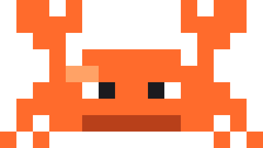
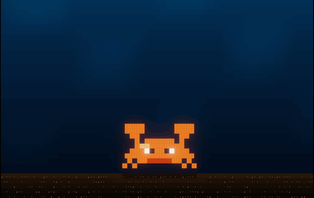
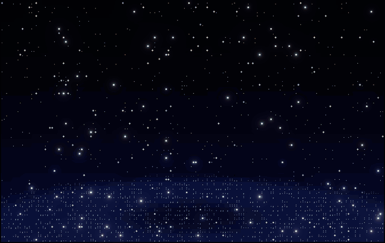
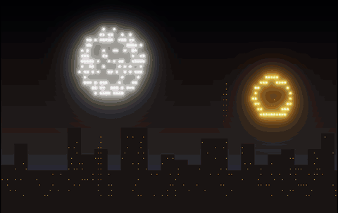
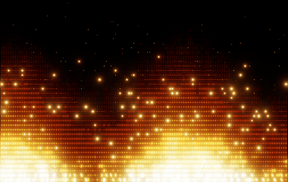
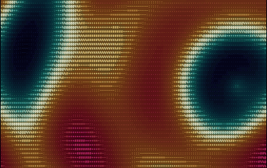
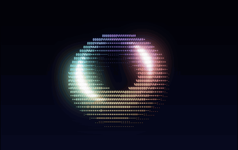
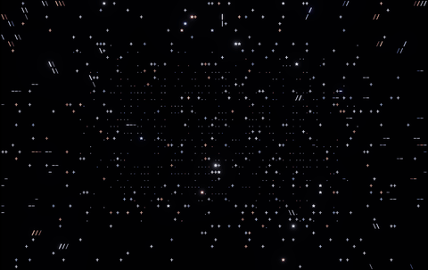

<p align="center">
  
</p>

<h1 align="center">rusteezy</h1>

<p align="center">
  <a href="https://crates.io/crates/rusteezy"></a>
  <a href="https://docs.rs/rusteezy"></a>
  <a href="https://github.com/Mwrnk/rusteezy/actions/workflows/ci.yml"></a>
  
</p>

<p align="center">
  A GPU-accelerated ASCII renderer for Rust: a character grid with real glow,
  smooth color, and physics, at hundreds of frames per second.
</p>

<p align="center">
  
</p>

You fill a grid of character cells (glyph, colors and a `glow` amount), and
rusteezy draws the whole grid in **one instanced draw call** into an HDR image.
A **bloom** pass then lets bright cells bleed light onto their neighbours, which
no terminal can do.

- **Fast:** a full-window grid in a couple of milliseconds per frame ([numbers](#performance))
- **Bloom:** soft threshold, dual-filter blur, ACES tonemapping
- **Smooth:** fixed-step simulation, easing curves, tweens, OKLab color fades
- **Particles:** gravity, drag, wind, per-particle color, interpolated rendering
- **3D-friendly:** per-cell depth buffer for compositing ray-traced or splatted scenes
- **Batteries included:** bundled fonts with glyph fallback, PNG capture,
  deterministic frame recording, an off-screen benchmark

## Quickstart

```toml
[dependencies]
rusteezy = "0.1"
```

```rust
use rusteezy::{Config, Frame, Rgb, Scene};

struct Hello;

impl Scene for Hello {
    fn draw(&mut self, f: &mut Frame) {
        let (w, h) = f.size();
        let text = "hello, rusteezy";
        let x = (w as i32 - text.len() as i32) / 2;
        let pulse = 0.5 + 0.5 * (f.time as f32 * 3.0).sin();
        for (i, ch) in text.chars().enumerate() {
            // Hue sweeps across the word; `glow` feeds the bloom pass.
            let t = i as f32 / text.len() as f32;
            let color = Rgb::hex(0xff6a3d).lerp_oklab(Rgb::hex(0xffd23f), t);
            f.grid.overlay(x + i as i32, h as i32 / 2, ch, color, 0.5 + 1.5 * pulse);
        }
    }
}

fn main() -> Result<(), String> {
    rusteezy::run(Config::new("hello").with_args(), Hello)
}
```

Implement `Scene::update(dt, time)` for simulation (it runs at a fixed 240 Hz)
and `Scene::draw` to fill the grid each frame. `Grid::plot` writes with a depth
test and `Grid::overlay` writes unconditionally.

## Examples

```sh
cargo run --release --example tree
```

<table>
  <tr>
    <td></td>
    <td></td>
  </tr>
  <tr>
    <td align="center"><b>tree</b>: ray-traced cones, arc-length garland, snow, sparks</td>
    <td align="center"><b>fireworks</b>: particles, bursts, crackle, bloom</td>
  </tr>
  <tr>
    <td></td>
    <td></td>
  </tr>
  <tr>
    <td align="center"><b>fire</b>: per-cell heat diffusion with embers</td>
    <td align="center"><b>plasma</b>: scalar field, cycling OKLab palettes</td>
  </tr>
  <tr>
    <td></td>
    <td></td>
  </tr>
  <tr>
    <td align="center"><b>torus</b>: lit surface points, depth buffer, specular bloom</td>
    <td align="center"><b>starfield</b>: warp streaks with slope-matched glyphs</td>
  </tr>
</table>

| Example | Run | Keys |
|---|---|---|
| `hello` | `cargo run --release --example hello` | |
| `crab` | `cargo run --release --example crab` | |
| `tree` | `cargo run --release --example tree` | `R` rebuild · `G` garland mode · `B` bloom |
| `fireworks` | `cargo run --release --example fireworks` | `Space` volley |
| `fire` | `cargo run --release --example fire` | |
| `plasma` | `cargo run --release --example plasma` | `P` palette |
| `torus` | `cargo run --release --example torus` | |
| `starfield` | `cargo run --release --example starfield` | |

Every example accepts the same flags (see `rusteezy::cli`):

| Flag | Effect |
|---|---|
| `--font <px>` | cell size (default 10) |
| `--size <W>x<H>` | window size |
| `--hud` | show fps and timings (`F1` toggles) |
| `--uncapped` | no vsync |
| `--bench [frames]` | off-screen benchmark, prints stats and quits |
| `--shots <dir> <t1,t2,…>` | save PNGs at those times |
| `--record <file.rgb> --fps N --start S --seconds S` | record raw frames (see `scripts/gif.sh`) |

## Performance

`--bench` renders the full pipeline off-screen and waits for the GPU on every
frame, which is the most conservative measurement. Apple M2, 2560×1634 px,
213×68 grid (default font), `--size 1280x860 --bench 1500`:

| Example | avg frame | p99 frame |
|---|---|---|
| tree | 2.2 ms (≈455 fps) | 4.6 ms (≈220 fps) |
| fireworks | 2.2 ms (≈455 fps) | 4.3 ms (≈235 fps) |
| torus | 3.7 ms (≈275 fps) | 5.6 ms (≈180 fps) |

On macOS a window presents at the display's refresh rate even with `--uncapped`.

## How it works

See [docs/design.md](https://github.com/Mwrnk/rusteezy/blob/main/docs/design.md) for the frame pipeline, timing and the
approaches that were considered.

## Making the GIFs

```sh
scripts/gifs.sh            # all of them (needs ffmpeg)
scripts/gif.sh torus 0 5   # one example: start at 0 s, record 5 s
```

## Fonts

The `default-font` feature (on by default) bundles **Cascadia Mono** (SIL Open
Font License 1.1) with **DejaVu Sans Mono** as a fallback for glyphs Cascadia
lacks (★ ✦). Their licenses are in [`assets/fonts/`](https://github.com/Mwrnk/rusteezy/tree/main/assets/fonts). To use your
own font, set `Config::font` and `Config::fallback_fonts`, and turn off default
features if you want to drop the bundled ones.

## License

Licensed under either of [Apache License 2.0](https://github.com/Mwrnk/rusteezy/blob/main/LICENSE-APACHE) or
[MIT license](https://github.com/Mwrnk/rusteezy/blob/main/LICENSE-MIT) at your option.

Unless you explicitly state otherwise, any contribution intentionally submitted
for inclusion in this crate by you, as defined in the Apache-2.0 license, shall
be dual licensed as above, without any additional terms or conditions.
